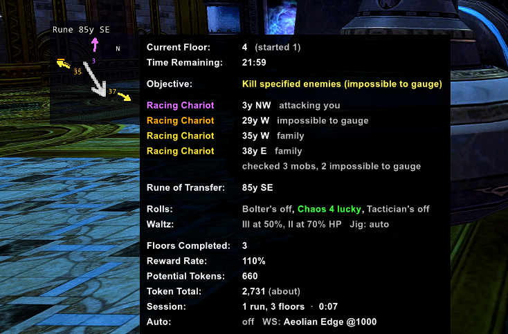
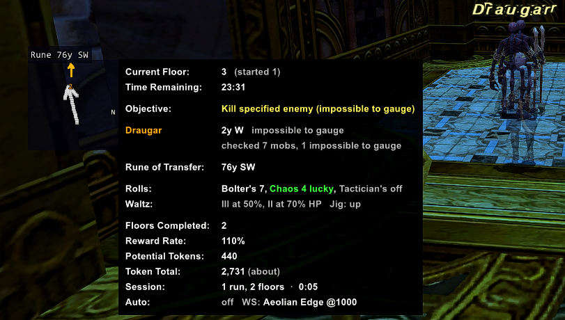
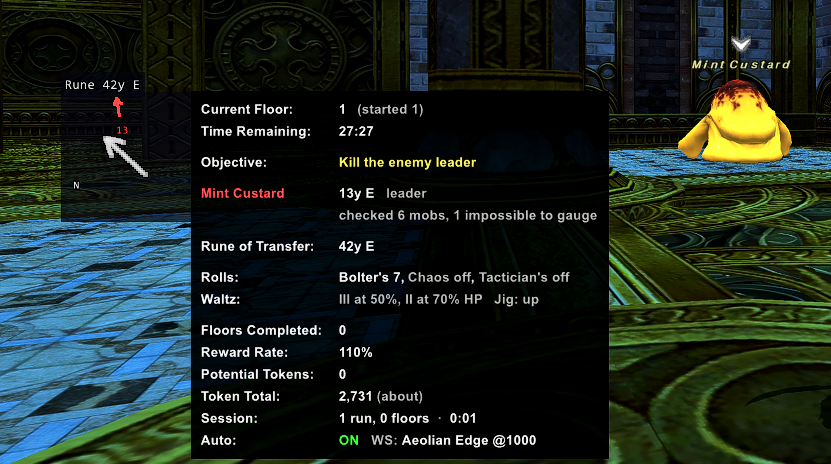
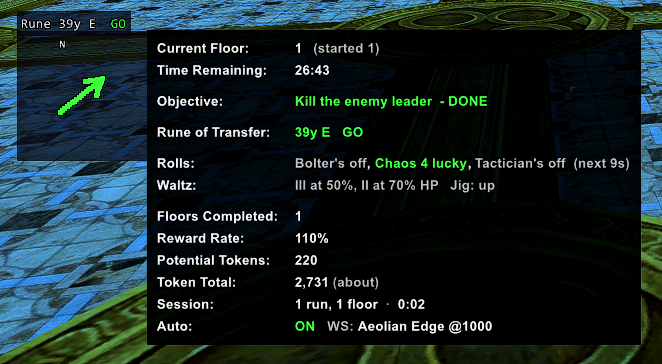
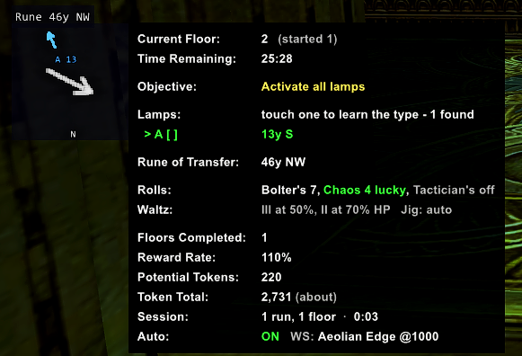
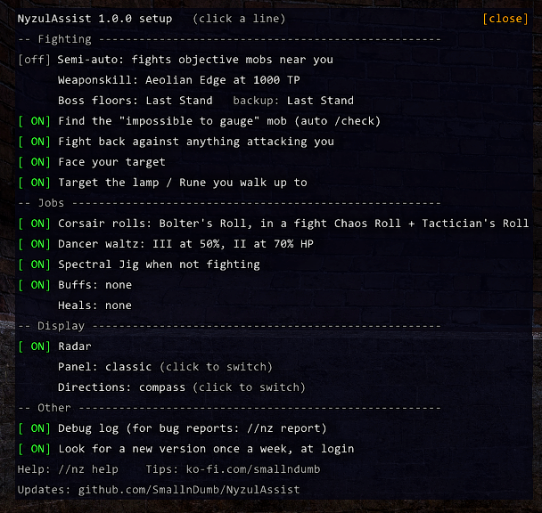

# NyzulAssist

A Windower 4 addon for **Nyzul Isle Investigation**. It shows everything you need on each floor in one panel, finds the "impossible to gauge" target for you, solves the lamp puzzles, points the way with a radar, and can do the fighting while you do the walking.

Free, by SmallnDumb. If it saves you time, tips are welcome at [ko-fi.com/smallndumb](https://ko-fi.com/smallndumb).

Questions, ideas and news: the [NyzulAssist thread on FFXIAH](https://www.ffxiah.com/forum/topic/59152/nyzulassist-nyzul-isle-helper).



## Features

- **Floor panel:** floor, run timer, objective, the floor's rule (Archaic Gears), Pathos penalties, the Rune of Transfer's distance and direction, and a token estimate.
- **Target finder:** on "specified enemy" floors it runs /check on the mobs around you and tells you which one is "impossible to gauge". On "enemy leader" floors it picks out the leader or boss.
- **Lamp solver:** for in-order lamps it suggests the order to try and works out the right one round by round. For all-at-once lamps it suggests the shortest route between them and counts down until you can try again.
- **Radar:** a small box with a big arrow to the Rune of Transfer and small coloured arrows to your targets and the next lamp.
- **Semi-auto (optional):** it fights objective mobs that come within range, faces them and uses your weaponskill. **You do all the moving.**
- **Jobs:** Corsair rolls with Double-Up, Dancer waltzes and Spectral Jig, and buffs / heals you choose for any job.
- **Tokens and stats:** your token total, what each session made you, and tokens per hour.
- **Setup window:** `//nz setup` - click to switch things on and off.

## Screenshots

| | |
|---|---|
|  |  |
| The "impossible to gauge" Draugar, 2 yalms west | The leader on an enemy-leader floor |
|  |  |
| Floor done: **GO** and the arrow to the Rune | A lamp floor, with the next lamp on the radar |



## Install

1. Download the latest `NyzulAssist-x.y.z.zip` from the [Releases page](https://github.com/SmallnDumb/NyzulAssist/releases) (not the "Source code" files).
2. Unzip it into `Windower/addons/`, so the file ends up at `Windower/addons/NyzulAssist/NyzulAssist.lua`.
3. In game, type `//lua load nyzulassist`. To load it every time, add `lua load nyzulassist` to `Windower/scripts/init.txt`.

The panel appears when you enter Nyzul Isle. Drag it to move it.

## Quick start

1. `//nz setup` opens the setup window. Click a line to switch it on or off.
2. Set your weaponskill: `//nz ws Savage Blade 1000` (the name, then the TP to use it at).
3. Turn on semi-auto: `//nz auto`. It fights; you walk to the mobs, lamps and the Rune.

Everything else works without semi-auto: the panel, target finder, lamp solver and radar are always on.

## On each floor

| Objective | What it does |
|---|---|
| **Specified enemy / enemies** | /checks normal mobs within 30 yalms, one at a time, and lists the "impossible to gauge" one with its distance and direction. Named NMs that also check impossible to gauge (Tom Tit Tat, Odqan...) don't count, so they're skipped. |
| **Enemy leader** | Lists the leader NM, or the boss on floors 20/40/60/80/100. |
| **All enemies** | Lists every enemy you can see, including Archaic Ramparts (they count on these floors). |
| **Lamps: in order** | Labels the lamps A-E and suggests an order (**Try: C > A > D > B**, next lamp in green). After each round it reads which lamps stayed lit and narrows it down. If a lamp was out of view, it fills it in as you walk past, or you can type `//nz lit AC`. |
| **Lamps: all at once** | Suggests the shortest route from the first lamp to the last, and counts down until the lamps can be touched again after a failed try. |
| **Floor done** | The panel and radar say **GO** and point to the Rune of Transfer. |

Directions are compass points that match the in-game map (`26y NE`). `//nz dir clock` switches to clock positions (12 o'clock = straight ahead).

## Semi-auto (`//nz auto`)

- Fights an objective mob once it's within 15 yalms (`//nz range 20` to change), and fights back against anything attacking you.
- Faces your target and uses your weaponskill at your TP.
  - `//nz ws boss <name> [TP]` - a different weaponskill for boss floors.
  - `//nz ws backup <name>` - used on mobs your weaponskill heals, and instead of an area weaponskill next to an Archaic Gear.
- Never fights an Archaic Gear on "Do not destroy archaic gears" floors.
- Targets the next lamp, or the Rune once the floor is done, when you walk up to it. You press Enter and answer the menu yourself.
- **Pauses** on a /tell or a GM message, and turns off when you die or leave Nyzul.

## Jobs

**Corsair** (main job): keeps Bolter's Roll up between fights and your combat rolls up in fights (Chaos + Tactician by default; Samurai Roll too), and only Double-Ups when it can't bust. It holds rolls while you have 800+ TP (roll gear resets TP), and keeps abilities away from Archaic Gears, which they aggro.

- `//nz rolls idle bolter`, `//nz rolls combat chaos tactician`, `//nz rolls tp 1000`, `//nz cor off`

**Dancer** (main or sub): Curing Waltz III at 50% HP and II at 70%, and Spectral Jig when you're not fighting. Invisible is clicked off as you walk up to the lamp or Rune you need.

- `//nz waltz 40 65`, `//nz jig off`, `//nz jig lamps off`

**Any job: buffs and heals you choose.** Name a job ability or spell and it keeps it up, or uses it whenever it's ready if it doesn't give a status (like Jump). Heals are used at or below the HP you set.

```
//nz buff add Berserk                  (in fights - the default)
//nz buff add Hasso always             (in and out of fights)
//nz buff add Protect IV idle          (out of fights)
//nz heal add Cure IV 40               (at or below 40% HP)
//nz buff     //nz heal                (list them)
//nz buff remove Hasso    //nz buff off
```

- Abilities and spells that go on an enemy (Jump, Provoke, Drain) are used on your target, in fights only.
- Spells are only cast while you're standing still, and only ones you've learned on your current jobs.
- Out of a fight, buffs wait while you're invisible, so they don't take Invisible off.
- If one doesn't work three times in a row (it never goes off, or its status never shows up), it's left alone for two minutes and it tells you.

## Panel and radar

- `//nz style compact` switches to a smaller single-box panel; `//nz font Arial 13` and `//nz spacing 5 9` change the look.
- The radar's big arrow points to the Rune (green once the floor is done). Small arrows: **red** leader/boss, **orange** impossible-to-gauge, **yellow** specified family, **purple** attacking you, **blue** the next lamp.
- `//nz radar up north` keeps north at the top; by default up is the way you're looking.
- `//nz hide` / `//nz show` hides or shows both.

## Tokens and stats

The panel shows your token total and what this session has made after paying to start each run. Talk to the Sorrowful Sage once and it knows exactly how many tokens you have. `//nz stats` shows this session's runs, floors cleared and tokens per hour; `//nz tokens` shows the totals.

## Commands

`//nz help` lists the groups, `//nz help all` lists everything. The main ones:

| Command | |
|---|---|
| `//nz setup` | the setup window |
| `//nz auto` | semi-auto on / off |
| `//nz ws <name> <TP>` | your weaponskill |
| `//nz buff add <name>` / `//nz heal add <name> <HP%>` | buffs and heals for any job |
| `//nz lit <letters>` | which lamps stayed lit, if it couldn't see them |
| `//nz stats` / `//nz tokens` | this session / your token totals |
| `//nz hide` / `//nz show` | the panel and radar |
| `//nz report` | a file to send with a bug report |
| `//nz update` / `//nz update on` | look for a newer version now / once a week |

## Bug reports

1. Type `//nz debug` to turn on the debug log (it starts a fresh one each time).
2. Make it happen again.
3. Type `//nz report`. It saves `data/report.txt` in the addon folder with your settings and the end of the log.
4. Open an issue on [GitHub](https://github.com/SmallnDumb/NyzulAssist/issues) (or post in the [FFXIAH thread](https://www.ffxiah.com/forum/topic/59152/nyzulassist-nyzul-isle-helper)) and attach that file.

## Updates

- `//nz update` looks for a newer version now. A command window may flash up for a moment while it checks.
- `//nz update on` checks once a week when you log in, and only says something if there's a new version.
- `//nz version` shows what you have. What changed is in [CHANGELOG.md](CHANGELOG.md).
- To hear about new versions without the addon checking, watch the [GitHub page](https://github.com/SmallnDumb/NyzulAssist) (Watch > Custom > Releases).

## Is it safe to use?

Square Enix's terms don't allow third-party tools, and that includes Windower and its addons, so any addon carries some risk. NyzulAssist does not walk for you. Semi-auto only fights mobs that are already near you, uses your weaponskill and the abilities you've chosen, and leaves all the moving to you. With semi-auto off, the automatic /check (one every 1.5 seconds at most) is the only thing it sends to the server on its own; `//nz check off` turns it off. Use it at your own risk.

## Credits

Chat message formats, the token formula and the lamp / Rune entity numbers were learned from **NyzulHelper** (Glarin of Asura), **NyzulBuddy** (Darkdoom) and **NyzulBestBuddy** (LordAttilas). Objective, leader and family lists come from bg-wiki. Targeting uses the same technique as Windower's SetTarget addon.

BSD 3-Clause licence - see [LICENSE](LICENSE).
